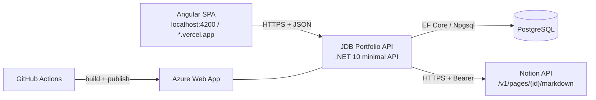
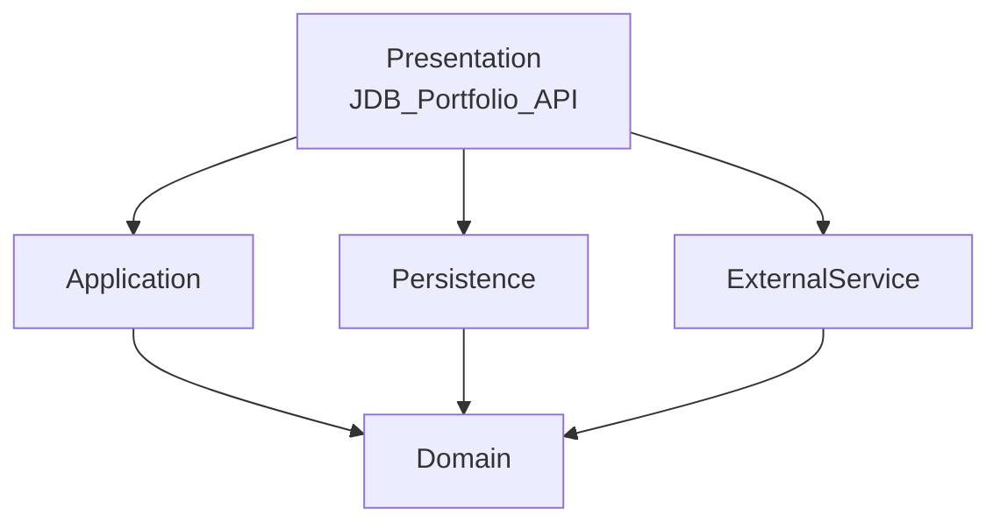
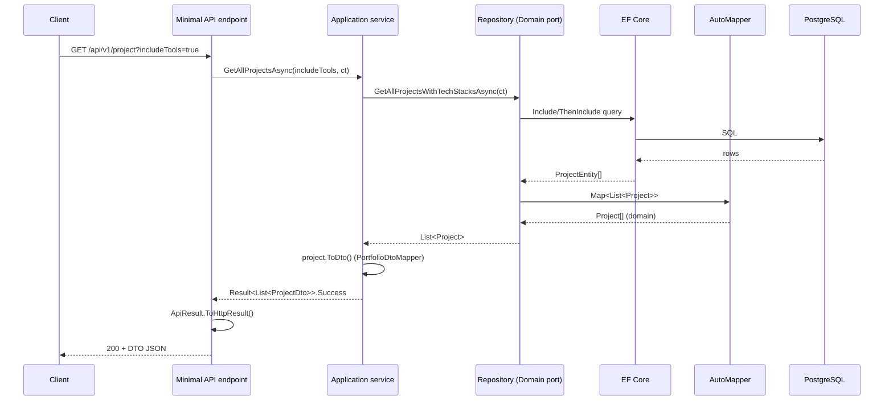

# Architecture

Descriptive: how the system is built **today**, and what it is meant to become.
Normative rules live in [`../rules/architecture.md`](../rules/architecture.md).

## 1. System context



Single bounded context: **Portfolio**. Read-only. No message broker, no cache, no
background jobs, no identity provider.

## 2. Projects and responsibilities

```
src/
├── JDB_Portfolio_API.Domain/            ← core, no dependencies
│   ├── Entities/                        Experience, Project, TechStack,
│   │                                    TechStackCategory, Recommendation
│   ├── ValueObjects/                    Role, Company, Period, TechStackRef
│   └── Interfaces/                      IRepository<T>, IPortfolio*Repository
│                                        (ports only — no vendor types; 3.2, ADR-0005)
│
├── JDB_Portfolio_API.Application/       ← core, references Domain
│   ├── Common/Result.cs                 Result<T> + typed Error (ErrorKind, code)
│   ├── Abstractions/                    IPageContentReader (3.2, ADR-0005)
│   ├── Models/                          DashboardItem, PageContent
│   ├── Services/                        PortfolioService, PortfolioExperienceService,
│   │                                    PortfolioProjectService,
│   │                                    PortfolioRecommendationService,
│   │                                    PortfolioSkillService,
│   │                                    PortfolioServiceBase<T,TRepository>
│   ├── DTO/                             the published contracts (AuthDto, *Dto)
│   └── Settings/JwtOptions.cs
│
├── JDB_Portfolio_API.Persistence/       ← infrastructure
│   ├── Contexts/PortfolioContext.cs     DbContext + fluent config (partial, DB-first)
│   ├── Contexts/PortfolioContextFactory.cs  design-time factory (env-var user secrets id)
│   ├── Entities/                        *Entity + ProjectTechStack join
│   ├── Repositories/                    BasePortfolioRepository<TDomain,TEntity>
│   │                                    + 4 concrete repositories
│   ├── Profiles/PortfolioMappingProfile.cs  entity ↔ domain AutoMapper profile
│   └── Migrations/                      9 migrations + snapshot
│
├── JDB_Portfolio_API.ExternalService/   ← infrastructure
│   └── Notion/                          NotionClientService, parser, settings, DTO,
│                                        Models/NotionPage (vendor shape)
│
└── JDB_Portfolio_API/                   ← presentation / composition root
    ├── Program.cs                       builder, middleware, endpoint mapping
    ├── ConfigurationSettings.cs         DI extensions (all in one class; 4.1 splits it)
    ├── Adapters/                        NotionPageContentReader — bridges the Application
    │                                    port to the Notion client (ADR-0005)
    ├── Authentication/                  JwtTokenService, Swagger security filter
    ├── ErrorHandling/                   GlobalExceptionHandler (2.4)
    └── Endpoints/                       one static class per area + ApiResult
```

## 3. Dependency graph (actual)



All arrows point inward. `Persistence` no longer references `Application`
(1.1), and no project references Presentation.

## 4. Request flow

### Read (all current endpoints)



Two things to notice:

1. **Domain types stop at the service boundary.** The service maps domain → DTO by
   hand (`PortfolioDtoMapper`, ADR-0004); the endpoint signature and the response
   contain DTOs only.
2. `Result<T>` is produced by `PortfolioServiceBase.ExecuteAsync`, which classifies
   failures into a typed `Error`. `Endpoints/ApiResult.cs` is the only place that maps
   the error kind to a status code (`503` for the database, `502` for Notion, `500` for
   a bug), and `GlobalExceptionHandler` covers exceptions that escape a service.

### Write (not built)

There is no write path. `IRepository<T>` exposes only `GetAllAsync`, and `AddNewAsync`
is gone. The target seam is `IUnitOfWork` (plan 4.4); `Project` is the aggregate root
and `IPortfolioProjectRepository` its future write entry point (ADR-0003).

## 5. Composition root

`Program.cs` is the only place the graph is assembled:

```
builder.Services
  .AddSwaggerConfig(...)     → Swashbuckle, JWT security scheme
  .AddDatabase(...)          → DbContext + ALL repositories/services (misfiled)
  .AddExternalService(...)   → Notion HttpClient + IPageContentReader (adapter in Adapters/)
  .AddAuthentication(...)    → JwtOptions + JwtBearer + AddAuthorization + IAuthTokenService
  .AddMapper(...)            → AutoMapper profile
  .AddCorsOrigins(configuration, environment)  → "AllowSPA" policy

app
  .UseExceptionHandler()     → ProblemDetails for anything that escapes
  .UseCors("AllowSPA")
  .UseHttpsRedirection()
  .UseAuthentication()
  .UseAuthorization()
  app.MapGroup("api/v1") → .MapAuthEndpoints() / .MapNotionEndpoints() /
                           .MapPortfolio*Endpoints() / .MapOverview()
```

Issues:

- `AddDatabase` registers application services — the method name lies
  (plan 4.1).
- `AddControllers()` / `MapControllers()` are called but no controllers exist.
- `Database.Migrate()` runs at startup inside a scope, before the pipeline.
- Swagger is Development-only.

## 6. Cross-cutting concerns

| Concern | Today | Gap |
|---|---|---|
| Error handling | `try/catch` per service → `Result<T>` with a typed `Error` → one mapper in `ApiResult.cs` → `503`/`502`/`500`; `GlobalExceptionHandler` for anything outside a service (2.2, 2.4) | — |
| Logging | `ILogger` in the Application services — warning for a dependency failure, error for a bug — plus the default ASP.NET request log | no structured sink, no correlation id; the provider's exception detail lives only in the log |
| Validation | explicit `AuthDto` guard in `AuthEndpoints` → `400 + validation_failed` (2.5) | no other endpoint takes input |
| Cancellation | `CancellationToken` is a required parameter from endpoint → service → repository → `ToListAsync(ct)` / `HttpClient.GetAsync(ct)` | — |
| Mapping | AutoMapper for entity ↔ domain; hand-written `PortfolioDtoMapper` for domain → DTO (ADR-0004) | reverse maps are explicit but unused until a write path exists |
| Auth | JWT **service token** (`sub=portfolio-api`); only `/auth/me` requires it, the portfolio endpoints are anonymous on purpose (2.5) | no user authentication; no secure-by-default fallback policy until a write endpoint exists |
| Observability | none | no health check, no metrics, no tracing |
| Resilience | none | Notion call has no timeout/retry policy |

## 7. Deployment topology

- **CI:** GitHub Actions on push to `main` — restore, build Release, publish,
  Azure OIDC login, `azure/webapps-deploy`.
- **Host:** Azure Web App (`jdb-portfolio-api`), single instance.
- **Database:** PostgreSQL, connection via `ConnectionStrings__JDBConnection`.
- **Docker:** multi-stage image; `docker-compose.yml` runs the API only and
  expects an external PostgreSQL supplied through `docker/.env`.

## 8. Where this is going

Plan [`001`](../plans/001-clean-architecture-refactor.md) Parts 1–3 are complete
(2026-10-23): dependency direction is clean, the domain has invariants and value
equality, DTOs sit at the edge, errors are typed, and 179 tests cover the invariants,
mappings and endpoint contracts. What remains is the optional Part 4 polish — the
composition-root split (4.1), `Directory.Build.props` (4.5), `IEntityTypeConfiguration`
split (4.3), the Notion client/parser cleanup (4.6, 4.7), and `IUnitOfWork` (4.4) before
any write endpoint is added.

Open architectural decisions are tracked as ADRs in [`adr/`](adr/).
