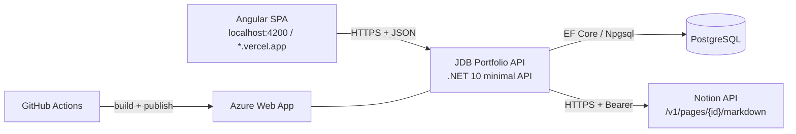
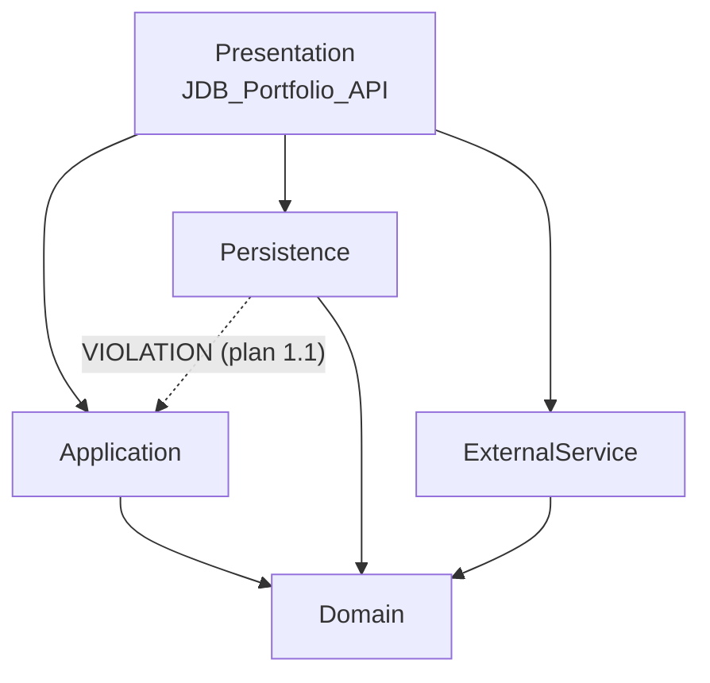
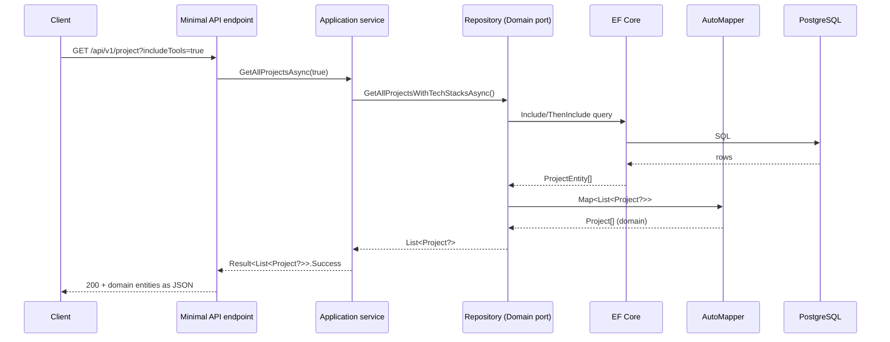

# Architecture

Descriptive: how the system is built **today**, and what it is meant to become.
Normative rules live in [`../rules/architecture.md`](../rules/architecture.md).

## 1. System context



Single bounded context: **Portfolio**. Read-only. No message broker, no cache, no
background jobs, no identity provider.

## 2. Projects and responsibilities

```
src/
├── JDB_Portfolio_API.Domain/            ← core, no dependencies
│   ├── Entities/                        Experience, Project, TechStack,
│   │                                    TechStackCategory, Recommendation,
│   │                                    DashboardItem (misplaced, see plan 3.2)
│   ├── ValueObjects/                    Role, Company, Period, NotionPage
│   │                                    (misplaced)
│   └── Interfaces/                      IRepository<T>, IPortfolio*Repository,
│                                        INotionService (misplaced)
│
├── JDB_Portfolio_API.Application/       ← core, references Domain
│   ├── Common/Result.cs                 Result<T> (string error today)
│   ├── Services/                        PortfolioService, PortfolioExperienceService,
│   │                                    PortfolioProjectService,
│   │                                    PortfolioRecommendationService,
│   │                                    PortfolioSkillService,
│   │                                    PortfolioServiceBase<T,TRepository>
│   ├── DTO/                             AuthDto
│   └── Settings/JwtOptions.cs
│
├── JDB_Portfolio_API.Persistence/       ← infrastructure
│   ├── Contexts/PortfolioContext.cs     DbContext + fluent config (partial, DB-first)
│   ├── Contexts/PortfolioContextFactory.cs  design-time factory (env-var user secrets id)
│   ├── Entities/                        *Entity + ProjectTechStack join
│   ├── Repositories/                    BasePortfolioRepository<TDomain,TEntity>
│   │                                    + 4 concrete repositories
│   ├── Profiles/PortfolioMappingProfile.cs  entity ↔ domain AutoMapper profile
│   └── Migrations/                      6 migrations + snapshot
│
├── JDB_Portfolio_API.ExternalService/   ← infrastructure
│   └── Notion/                          NotionClientService, parser, settings, DTO
│
└── JDB_Portfolio_API/                   ← presentation / composition root
    ├── Program.cs                       builder, middleware, endpoint mapping
    ├── ConfigurationSettings.cs         DI extensions (all in one class)
    └── Endpoints/                       7 static classes, one per area
```

## 3. Dependency graph (actual)



Target: delete the dotted edge. Everything else is already correct.

## 4. Request flow

### Read (all current endpoints)



Two things to notice:

1. There is **no DTO step** — the domain object is the response.
2. `Result<T>` is produced by a `try/catch` in the service, and the endpoint maps
   any failure to `502`.

### Target

```
endpoint → handler/service → repository → EF
         ← DTO              ← domain entity
```

Domain types stop at the application boundary. `Result<T>` carries an error
kind, and one mapper turns it into `ProblemDetails`.

## 5. Composition root

`Program.cs` is the only place the graph is assembled:

```
builder.Services
  .AddSwaggerConfig(...)     → Swashbuckle, JWT security scheme
  .AddDatabase(...)          → DbContext + ALL repositories/services (misfiled)
  .AddExternalService(...)   → Notion HttpClient + INotionService
  .AddAuthentication(...)    → JwtOptions + JwtBearer + AddAuthorization
  .AddMapper(...)            → AutoMapper profile
  .AddCorsOrigins();         → "AllowSPA" policy

app
  .UseCors("AllowSPA")
  .UseHttpsRedirection()
  .UseAuthentication()
  .UseAuthorization()
  .MapAuthEndpoints() / .MapNotionEndpoints() / .MapPortfolio*Endpoints()
  .MapOverview()
```

Issues:

- `AddDatabase` registers application services — the method name lies
  (plan 4.1).
- `AddControllers()` / `MapControllers()` are called but no controllers exist.
- `Database.Migrate()` runs at startup inside a scope, before the pipeline.
- Swagger is Development-only.

## 6. Cross-cutting concerns

| Concern | Today | Gap |
|---|---|---|
| Error handling | `try/catch` per service → `Result<T>` → `502` | no global handler, wrong status codes, wrong exception type |
| Logging | default ASP.NET request logs | no `ILogger` in services, no context on failure |
| Validation | none | `AuthDto` accepts anything |
| Cancellation | none | no `CancellationToken` anywhere |
| Mapping | AutoMapper, entity → domain | no DTO mapping, broken reverse mappings |
| Auth | JWT issued, not enforced | `RequireAuthorization()` commented out |
| Observability | none | no health check, no metrics, no tracing |
| Resilience | none | Notion call has no timeout/retry policy |

## 7. Deployment topology

- **CI:** GitHub Actions on push to `main` — restore, build Release, publish,
  Azure OIDC login, `azure/webapps-deploy`.
- **Host:** Azure Web App (`jdb-portfolio-api`), single instance.
- **Database:** PostgreSQL, connection via `ConnectionStrings__JDBConnection`.
- **Docker:** multi-stage image; `docker-compose.yml` runs the API only and
  expects an external PostgreSQL supplied through `docker/.env`.

## 8. Where this is going

Plan [`001`](../plans/001-clean-architecture-refactor.md) moves the system
toward:

- strict dependency direction;
- a domain model with invariants and value equality;
- DTOs at the edge;
- typed errors + `ProblemDetails`;
- tests at the domain, application, and API layers.

Open architectural decisions are tracked as ADRs in [`adr/`](adr/).
