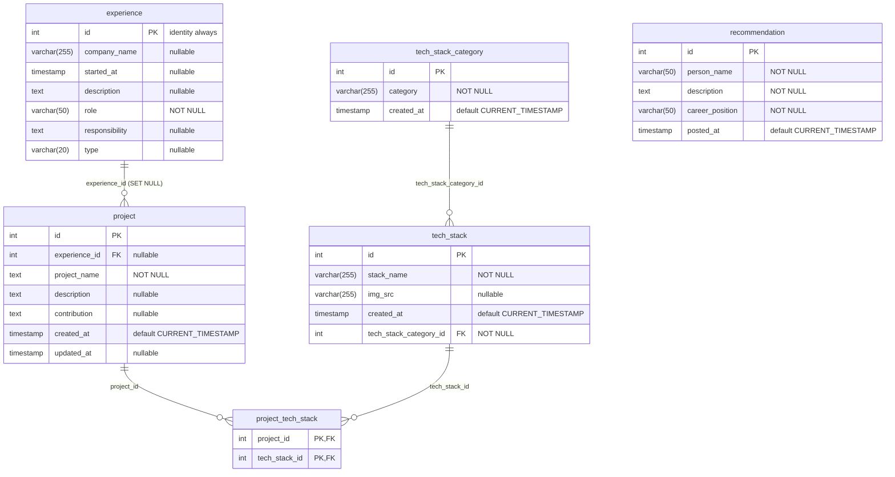

# Database

PostgreSQL via EF Core 10 + Npgsql. Schema is managed by migrations in
`src/JDB_Portfolio_API.Persistence/Migrations/`.

## 1. Entity-relationship diagram



## 2. Tables

| Table | Rows represent | Notes |
|---|---|---|
| `experience` | a role held at a company | **no `finished_at`**, no `created_at`/`updated_at` |
| `project` | delivered work | `experience_id` is nullable, `ON DELETE SET NULL` |
| `project_tech_stack` | many-to-many join | composite PK `(project_id, tech_stack_id)` |
| `tech_stack` | a technology | `tech_stack_category_id` required |
| `tech_stack_category` | technology grouping | — |
| `recommendation` | a testimonial | `posted_at` defaults to `CURRENT_TIMESTAMP` |

## 3. Conventions

- **Singular, `snake_case`** table and column names.
- Primary key `id` with `UseIdentityAlwaysColumn()` (PostgreSQL `GENERATED
  ALWAYS AS IDENTITY`).
- Constraint names: `<table>_pkey`, `FK_<table>_<column>`.
- Foreign key `project.experience_id` uses `ON DELETE SET NULL`, so deleting an
  experience detaches its projects rather than deleting them. This is a
  deliberate modelling choice that contradicts "Experience owns Project".
- **Timestamps are `timestamp without time zone`.** Every value is written as
  UTC by convention only; the database does not enforce it. New columns should
  use `timestamptz`.

## 4. Migration history

| Migration | Purpose |
|---|---|
| `20260808053318_InitialCreate` | experience, project, recommendation, tech_stack, tech_stack_category |
| `20260809073438_AddProjectWithTechStack` | join table |
| `20260809080136_UpdateSchema` | column adjustments |
| `20260809090012_UpdateProjectAndRecommendationSchema` | project/recommendation columns, table renames |
| `20260809121352_RenameProjectTechStackColumns` | join column names |
| `20260822074954_ProdBaseline` | production baseline (FK rename) |
| `20261021161825_NormalizeIdentifierNames` | renames identifiers the old chain left stale |

A squash into a single `InitialCreate` was prepared and then abandoned. It
produced the same schema, but applying it to an environment that was already
migrated required rewriting `__EFMigrationsHistory` — a one-off manual step per
database. The additive migration keeps every environment, including production,
on the ordinary `Migrate()` path.

`NormalizeIdentifierNames` fixes three names left behind when the table was
renamed from `recommendations` to `recommendation`:

| Before | After |
|---|---|
| `recommendations_pkey` | `recommendation_pkey` |
| `PK_project_tech_stack` | `project_tech_stack_pkey` |
| `recommendations_id_seq` | `recommendation_id_seq` |

The sequence rename cannot be generated by EF: identity sequence names are
assigned by convention at table creation and are not part of the model. It is
guarded raw SQL in the migration. A fresh database replays all seven migrations
and ends in exactly the same state as one that applied the squash.

From now on, name migrations for the change (`AddFinishedAtToExperience`).

## 5. Workflow

```bash
# add
dotnet ef migrations add AddFinishedAtToExperience \
  --project src/JDB_Portfolio_API.Persistence \
  --startup-project src/JDB_Portfolio_API

# review the generated Up/Down, then apply
dotnet ef database update \
  --project src/JDB_Portfolio_API.Persistence \
  --startup-project src/JDB_Portfolio_API

# list / rollback / remove (unapplied only)
dotnet ef migrations list   --project … --startup-project …
dotnet ef database update <PreviousMigration> --project … --startup-project …
dotnet ef migrations remove --project … --startup-project …
```

Full guide: `src/JDB_Portfolio_API.Persistence/Migrations/MIGRATION_GUIDE.md`.

**Prerequisite:** `dotnet-ef` is not installed and there is no local tool
manifest. `docker/README.md` says `dotnet tool restore`, which currently does
nothing. Install it globally or add `.config/dotnet-tools.json`.

## 6. Design-time context

`PortfolioContextFactory` builds a context for `dotnet ef` by reading
`appsettings.Development.json` plus a **hardcoded user-secrets GUID**
(`57d40eab-…`). That GUID belongs to one machine; another developer gets a null
connection string. Prefer:

```bash
dotnet ef ... --startup-project src/JDB_Portfolio_API
```

or read `ConnectionStrings__JDBConnection` from the environment (plan 1.8).

## 7. Runtime migration

`Program.cs` calls `dbContext.Database.Migrate()` at startup. Acceptable for one
instance; unsafe with multiple replicas (concurrent DDL). Gate it behind a
config flag, or move migrations to a deploy step.

## 8. Known schema gaps

| Gap | Impact | Plan |
|---|---|---|
| No `experience.finished_at` | past roles appear ongoing; duration grows daily | 1.3 / D1 |
| `project` has no period columns | `Project.Period` silently discarded | 1.4 |
| `timestamp without time zone` everywhere | timezone bugs when the host TZ changes | 4.x |
| No `CHECK` on `role` / `career_position` non-empty | empty strings crash the mapping | 1.5 |
| No index on `project.experience_id` | sequential scan as data grows | — |
| No unique constraint on `tech_stack.stack_name` | duplicates possible | — |
| `project.updated_at` is never maintained | column is dead weight | — |
