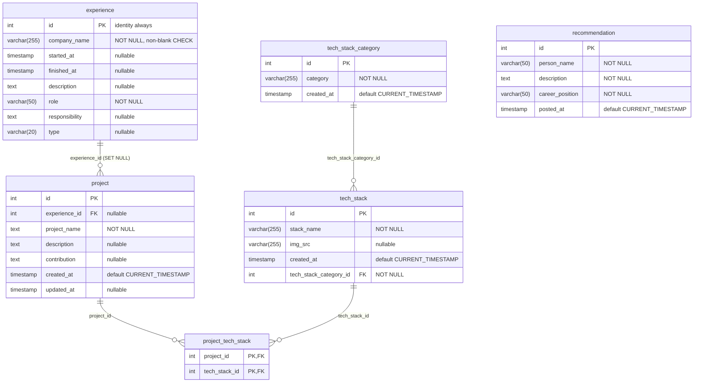

# Database

PostgreSQL via EF Core 10 + Npgsql. Schema is managed by migrations in
`src/JDB_Portfolio_API.Persistence/Migrations/`.

## 1. Entity-relationship diagram



## 2. Tables

| Table | Rows represent | Notes |
|---|---|---|
| `experience` | a role held at a company | `finished_at` is **nullable**: `NULL` means the role is **ongoing**, a date means it has ended. See §7. `company_name` is **required** and must not be blank (§3) |
| `project` | delivered work | `experience_id` is nullable, `ON DELETE SET NULL` |
| `project_tech_stack` | many-to-many join | composite PK `(project_id, tech_stack_id)` |
| `tech_stack` | a technology | `tech_stack_category_id` required |
| `tech_stack_category` | technology grouping | — |
| `recommendation` | a testimonial | `posted_at` defaults to `CURRENT_TIMESTAMP` |

## 3. Conventions

- **Singular, `snake_case`** table and column names.
- Primary key `id` with `UseIdentityAlwaysColumn()` (PostgreSQL `GENERATED
  ALWAYS AS IDENTITY`).
- Constraint names: `<table>_pkey`, `FK_<table>_<column>`, `ck_<table>_<rule>`.
- Foreign key `project.experience_id` uses `ON DELETE SET NULL`, so deleting an
  experience detaches its projects rather than deleting them. This is a
  deliberate modelling choice that contradicts "Experience owns Project".
- **Timestamps are `timestamp without time zone`.** Every value is written as
  UTC by convention only; the database does not enforce it. New columns should
  use `timestamptz`.
- **The empty string is a sentinel, and it means "not disclosed".**
  `experience.role` and `recommendation.career_position` are `NOT NULL`, but an
  empty value is *valid data*: it means the owner would rather not state the role
  or the career position. There is deliberately **no** `CHECK` constraint against
  it — the plan originally proposed one and it was rejected, because it would make
  a legitimate state impossible to express.
  The translation happens in `PortfolioMappingProfile`:

  - blank or whitespace in the database → `null` in the domain (`Role?`)
  - `null` in the domain → `''` when written back

  `Role` itself still refuses to hold an empty string. "Undeclared" is represented
  by the *absence* of a `Role`, not by a `Role` containing nothing — which is why
  one blank row no longer throws inside AutoMapper and 500s the collection.
  Covered by `UndeclaredRoleMappingTests`.
- **`experience.company_name` is the one exception, and the asymmetry is deliberate.**
  Since 3.1a it is `NOT NULL` **and** carries
  `CHECK (btrim(company_name) <> '')`, so neither `NULL` nor `''` nor whitespace
  can be stored. "Not disclosed" is a plausible answer for a *role*; a role with no
  employer is not a role. Anything that cannot be named is written as a truthful
  stand-in (`"Self-employed"`, `"Contract — NDA"`). Do not "fix" the asymmetry by
  adding a `CHECK` to `role` or by relaxing this one.
- **The other name columns are enforced by the domain only.** Since 3.3, `Project`,
  `Recommendation`, `TechStack` and `TechStackCategory` reject a blank `project_name`,
  `person_name`, `description` or `stack_name` in their constructors — but the schema has
  no `CHECK` on any of them, so a blank row is still possible at the database level and
  would now throw inside AutoMapper (`500` for the collection). The data was verified
  clean on 2026-10-22 (0 blank rows in all four columns). Making the schema match
  `company_name` is a separate migration, deliberately left out of 3.3.
- Check constraints are *not* stored in the read-optimized runtime model.
  Reading them from `context.Model` throws; use
  `context.GetService<IDesignTimeModel>().Model` when a test needs to assert on
  one.

## 4. Migration history

| Migration | Purpose |
|---|---|
| `20260808053318_InitialCreate` | experience, project, recommendation, tech_stack, tech_stack_category |
| `20260809073438_AddProjectWithTechStack` | join table |
| `20260809080136_UpdateSchema` | column adjustments |
| `20260809090012_UpdateProjectAndRecommendationSchema` | project/recommendation columns, table renames |
| `20260809121352_RenameProjectTechStackColumns` | join column names |
| `20260822074954_ProdBaseline` | production baseline (FK rename) |
| `20261021161825_NormalizeIdentifierNames` | renames identifiers the old chain left stale |
| `20261022064321_AddExperienceFinishedAt` | adds `experience.finished_at` (nullable) — one column, no data statement |
| `20261022150752_RequireCompanyName` | `experience.company_name` → `NOT NULL` + `CHECK (btrim(company_name) <> '')` — applied to the local dev database 2026-10-23; pending everywhere else (see below) |

### `RequireCompanyName` is applied locally only

The migration exists in the repository and the model snapshot matches it. It has run
against the local dev database (2026-10-23); no other environment has it yet. It applies
on the next `dotnet ef database update`, or automatically at the next deploy because
`Database:AutoMigrate` defaults to `true` (KI-038).

Two things to know before it runs:

- `SET NOT NULL` **fails** if any row still has `NULL`, and the `CHECK` fails if
  any row is blank or all-whitespace. That failure is intended: the migration was
  scaffolded with `defaultValue: ""`, which would have invented an empty company
  for every `NULL` row — and then been rejected by the `CHECK` anyway. It was
  removed by hand, while the migration was still unapplied, so editing it in place did
  not violate the "never edit an applied migration" rule. It has since run on the local
  dev database only.
- Verify the target database first:

  ```sql
  SELECT id, company_name FROM experience
  WHERE company_name IS NULL OR btrim(company_name) = '';
  ```

  Zero rows means the migration applies without touching data. Any row means
  fixing the data first — not adding a default.

A squash into a single `InitialCreate` was prepared and then abandoned. It
produced the same schema, but applying it to an environment that was already
migrated required rewriting `__EFMigrationsHistory` — a one-off manual step per
database. The additive migration keeps every environment, including production,
on the ordinary `Migrate()` path.

`NormalizeIdentifierNames` fixes three names left behind when the table was
renamed from `recommendations` to `recommendation`:

| Before | After |
|---|---|
| `recommendations_pkey` | `recommendation_pkey` |
| `PK_project_tech_stack` | `project_tech_stack_pkey` |
| `recommendations_id_seq` | `recommendation_id_seq` |

The sequence rename cannot be generated by EF: identity sequence names are
assigned by convention at table creation and are not part of the model. It is
guarded raw SQL in the migration. A fresh database replays every migration
and ends in exactly the same state as one that applied the squash.

## 5. Workflow

```bash
# add
dotnet ef migrations add AddFinishedAtToExperience \
  --project src/JDB_Portfolio_API.Persistence \
  --startup-project src/JDB_Portfolio_API

# review the generated Up/Down, then apply
dotnet ef database update \
  --project src/JDB_Portfolio_API.Persistence \
  --startup-project src/JDB_Portfolio_API

# list / rollback / remove (unapplied only)
dotnet ef migrations list   --project … --startup-project …
dotnet ef database update <PreviousMigration> --project … --startup-project …
dotnet ef migrations remove --project … --startup-project …
```

Full guide: `src/JDB_Portfolio_API.Persistence/Migrations/MIGRATION_GUIDE.md`.

**Prerequisite:** `dotnet tool restore` from the repo root. The manifest is
`dotnet-tools.json` at the repo root and pins `dotnet-ef` 10.0.10.

## 6. Design-time context

`PortfolioContextFactory` builds a context for `dotnet ef`. It reads
`appsettings.Development.json` (optional), the API project's User Secrets store,
then the `ConnectionStrings__JDBConnection` environment variable. The environment
variable takes precedence over both configuration files.

```bash
export ConnectionStrings__JDBConnection="Host=…;Database=…;Username=…;Password=…"
```

The factory uses the same User Secrets ID declared in
`src/JDB_Portfolio_API/JDB_Portfolio_API.csproj`; the ID is an identifier, not a
secret. Keep the matching value in `PortfolioContextFactory` synchronized if the
project's User Secrets ID changes.

Run EF commands with `--startup-project src/JDB_Portfolio_API` as shown in the
migration commands above. No extra user-secrets environment variable is needed.

## 7. Runtime migration

`Program.cs` calls `dbContext.Database.Migrate()` at startup, gated behind the
`Database:AutoMigrate` config flag (default `true`). Acceptable for one
instance; unsafe with multiple replicas (concurrent DDL). Set
`Database__AutoMigrate=false` when migrations are applied out of band.

EF Core 10 treats a model change with no matching migration as a **hard
error** — the app refuses to start with
`PendingModelChangesWarning`. A model change can therefore never reach
production without a migration.

## 8. Known schema gaps

| Gap | Impact | Follow-up |
|---|---|---|
| `experience.finished_at` exists but is **not backfilled** | past roles still report a growing duration until the end dates are filled in | Backfill the existing role end dates |
| `timestamp without time zone` everywhere | timezone bugs when the host TZ changes | Consider a separately reviewed schema migration |
| No index on `project.experience_id` | sequential scan as data grows | — |
| No unique constraint on `tech_stack.stack_name` | duplicates possible | — |
| `project.updated_at` is never maintained | column is dead weight | — |

## 9. Backfilling `experience.finished_at`

`finished_at IS NULL` means **the role is ongoing**. A past role needs its end
date, otherwise its duration is measured against today and grows every day.

The end date of one role is usually the start of the next one, so the data
suggests itself. Confirm the dates before applying:

```sql
-- preview
select id, company_name, started_at, finished_at, role
from experience order by started_at;

-- apply (one row per past role; leave the current role NULL)
update experience set finished_at = '2022-08-13' where id = 1;
update experience set finished_at = '2023-05-01' where id = 2;
update experience set finished_at = '2026-06-24' where id = 3;
```

Then `GET /api/v1/experience` reports a frozen duration for each past role, and
`finishedAt` is non-null.
