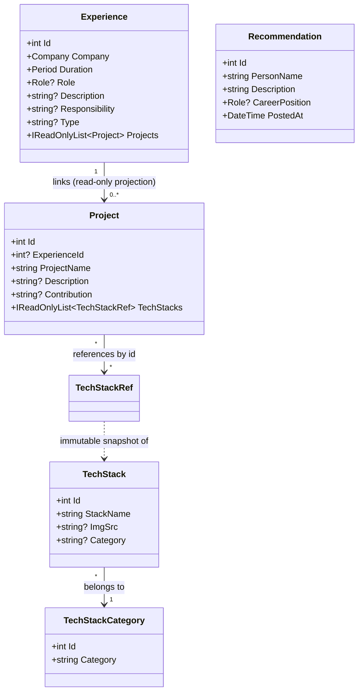

# Domain model

Descriptive: what the model is **today**. Intended design and open questions are
in [`../plans/001-clean-architecture-refactor.md`](../plans/001-clean-architecture-refactor.md)
and [`adr/0003-aggregate-boundary.md`](adr/0003-aggregate-boundary.md).

## 1. Bounded context

**Portfolio** — everything a visitor needs to read about a person's professional
history: roles held, projects delivered, technologies used, and what other people
said about them.

Out of scope for this context: writing content (no write endpoints), user
accounts, contact form, analytics, CMS.

## 2. Ubiquitous language

| Term | Meaning in this codebase |
|---|---|
| **Experience** | A role held at a company for a period. The closest thing to an aggregate root for employment history. |
| **Project** | Work delivered, optionally attached to an experience. |
| **TechStack** | A tool/technology, shared reference data. |
| **TechStackCategory** | Grouping for tech stacks (e.g. frontend, backend). |
| **Recommendation** | A testimonial: person, position, text, date. |
| **DashboardItem** | A UI widget count (projects/skills/recommendations). Not a domain concept. |
| **Role** | A job title value object (non-empty, ≤ 50 chars). |
| **Company** | An employer name value object (non-empty, ≤ 255 chars). Required on every experience. |
| **Period** | A time range with an optional end. |

## 3. Aggregate map (current)



**The boundary is settled (ADR-0003, 3.4).** `Project` is the aggregate root and the
only thing that owns the relationship: a project may exist with no experience, and
`Experience.Projects` is a read-only projection of the projects that point at it.
`TechStack` is shared reference data, so a project cites a `TechStackRef` (id + name +
image + category) rather than holding the entity — one project cannot mutate a stack
every other project cites. No write endpoint exists yet, so the rule is currently
enforced by shape (read-only collections, `AttachToExperience`, no write methods on any
repository), not by a transaction.

## 4. Entities

| Entity | Identity | Constructor | Mutability | Invariants enforced |
|---|---|---|---|---|
| `Experience` | `int Id` (DB identity) | `(id, company, period, role)` | `Id`/`Company` get-only; `Duration`/`Role`/`Description`/`Responsibility`/`Type` private set; `Projects` `IReadOnlyList` + `ReplaceProjects` | `Company` is **required** (3.1a); `Role` is **optional** — `null` means the role is deliberately undeclared; `Role`/`Company`/`Period` rules via VOs |
| `Project` | `int Id` (get-only) | `(id, projectName)` or `(id, experienceId, projectName, description, contribution, techStacks)` | id/name get-only; the rest private set through `Update…`/`AttachToExperience`/`ReplaceTechStacks` | **name non-blank** (3.3); holds `IReadOnlyList<TechStackRef>`, never `TechStack` entities (3.4). `Period` was removed on 2026-10-22: it had no column and no mapping, so it was always `null` |
| `TechStack` | `int Id` (get-only) | `(id, stackName, imgSrc, category)` | name/img get-only; category private via `SetCategory` | **name non-blank**; **category non-blank when present**, `null` allowed (3.3) |
| `TechStackCategory` | `int Id` (get-only) | `(id, category)` | both get-only | **name non-blank** (3.3) |
| `Recommendation` | `int Id` (get-only) | `(id, personName, description, careerPosition, postedAt)` | name/description/postedAt get-only; `CareerPosition` via `ChangeCareerPosition` | `PersonName` and `Description` **non-blank** (3.3, closes KI-041); `CareerPosition` is **optional** — `null` means it is deliberately not shown |

Behaviour that exists (plan 3.3 replaced public setters with these):

- `Experience.ChangeRole(Role?)` — sets or clears the role; `null` means "not declared".
- `Experience.UpdateDescription` / `UpdateResponsibility` / `UpdateType` — the last two were added by 3.3; before, the entity could not express its own fields and AutoMapper wrote them by reflection.
- `Experience.ReplaceProjects(IEnumerable<Project>?)` — copies the argument; `null` means none.
- `Project.AttachToExperience`, `UpdateDescription`, `UpdateContribution`, `ReplaceTechStacks`.
- `Recommendation.ChangeCareerPosition(Role?)`.
- `TechStack.SetCategory(string?)` — rejects blank, allows `null`.
- Nothing else. `Id`, `ProjectName`, `StackName`, `Category`, `PersonName`, `Description` and `PostedAt` cannot be changed after construction.

## 5. Value objects

| VO | Type | Validation | Equality | Notes |
|---|---|---|---|---|
| `Role` | `sealed record` | non-empty, ≤ 50 | **value** | "not disclosed" is `Role? == null`, never `""` |
| `Company` | `sealed record` | non-empty, ≤ 255 | **value** | never absent: "not disclosed" is not a thing for an employer, so there is no `Company?` (3.1a). The empty-string concept is gone (plan 3.1) |
| `Period` | `sealed record` | no `default` dates; `FinishedAt >= StartedAt`; `StartedAt` not in the future | **value** | `FinishedAt == null` means *ongoing* — see `IsOngoing` |
| `TechStackRef` | `sealed record` | non-blank name; non-blank category when present | **value** | A project's citation of a shared stack (3.4): identified by `Id`, immutable, so mutating one project's stack cannot reach another project |

Since 3.1 these hold:

```csharp
new Role("Developer") == new Role("Developer")        // true
new Company("Acme")    == new Company("Acme")         // true
new Period(start)      == new Period(start)           // true
```

and the three can be dictionary keys. Records generate `Equals`/`GetHashCode`/`==`
over every instance field, and each property is `get`-only, so the invariants hold:
a `with` expression cannot change a value and skip validation.

`Period.IsOngoing` names a fact that used to be folklore: it is true only when there
is a start date and no end date. `StartedAt == null && FinishedAt == null` is
"unknown", not "ongoing" — the two are different, and the mapper treats them
differently.

**One consequence to know about.** `Period` refuses a start date in the future
(compared by date, so time of day never decides). The mapping constructs a `Period`
for every row, so a future-dated row in the database now throws inside AutoMapper and
returns `500` for the whole collection rather than rendering a nonsense duration. That
is deliberate — a typo such as `2062` should be loud — but it means the invariant is
enforced on the read path until a write path exists to validate it earlier.

## 6. Invariants: current vs intended

| Invariant | Now | Intended |
|---|---|---|
| A project has a non-empty name | not enforced | constructor/factory throws |
| A project belongs to at most one experience | not modelled | enforced by aggregate root |
| A project has a non-empty name | **enforced (3.3)** | constructor throws |
| A tech stack has a non-empty name | **enforced (3.3)** | constructor throws |
| A tech stack category is non-blank when present | **enforced (3.3)** | `null` allowed; blank throws |
| A recommendation has a person and a description | **enforced (3.3)** | constructor throws |
| `Period.FinishedAt >= StartedAt` | enforced | enforced |
| `Role` non-empty and ≤ 50 | enforced | enforced |
| `Company` non-empty and ≤ 255 | **enforced (3.1)** | enforced, plus `NOT NULL` + non-blank `CHECK` (3.1a) |
| A role cannot start in the future | **enforced (3.1)** | enforced |
| Audit fields are not part of the domain | **enforced (3.3)** | removed from `TechStack`/`TechStackCategory`; the columns stay on the entities |

## 7. Types in the wrong layer

| Type | Where it is | Should be | Status |
|---|---|---|---|
| `DashboardItem` | `Application/Models` | — | **moved 2026-10-22** (3.2). A read model with no invariant; only `PortfolioService` and `PortfolioDtoMapper` ever touched it |
| `NotionPage` | `ExternalService/Notion/Models` (vendor) · `Application/Models/PageContent` (core) | — | **resolved 2026-10-23** (3.2, ADR-0005). The vendor model stays with the vendor client; the application reads `PageContent` through `IPageContentReader` |
| `INotionService` | `Application/Abstractions/IPageContentReader` | — | **resolved 2026-10-23** (3.2, ADR-0005). The Notion client implements nothing; `Presentation/Adapters/NotionPageContentReader` bridges the two |
| `ExperienceId` | deleted | — | resolved during the 1.x dead-code pass |
| `IService<T>` / `IMapper<,,>` | deleted | — | resolved during the 1.x dead-code pass |

Everything in this table is now resolved. The Notion pair needed a bridge rather than a
move: `Application` owns the port and cannot reference `ExternalService`, and
`ExternalService` implements the vendor call and cannot reference `Application`
(AGENTS §6 rule 2). The composition root is the only project that sees both, so the
adapter lives there — a deliberate, documented exception to "no behaviour in
Presentation", not a bent rule. See ADR-0005.

## 8. Domain events

None. There is no write path, so there is nothing to publish. When writes are
introduced, events should be raised by the aggregate and dispatched after
`SaveChanges`, not from the service.

## 9. Rules for changing the model

1. A new invariant gets a test **first** (see `rules/testing.md`).
2. Never add a public setter to fix a mapping problem — fix the mapping.
3. A value object that wraps a scalar gets a `record` and a validating
   constructor.
4. If a type has no behaviour and no invariant, ask whether it belongs in Domain
   at all.
5. Any change to the aggregate boundary needs an ADR.
