# Domain model

Descriptive: what the model is **today**. Intended design and open questions are
in [`../plans/001-clean-architecture-refactor.md`](../plans/001-clean-architecture-refactor.md)
and [`adr/0003-aggregate-boundary.md`](adr/0003-aggregate-boundary.md).

## 1. Bounded context

**Portfolio** — everything a visitor needs to read about a person's professional
history: roles held, projects delivered, technologies used, and what other people
said about them.

Out of scope for this context: writing content (no write endpoints), user
accounts, contact form, analytics, CMS.

## 2. Ubiquitous language

| Term | Meaning in this codebase |
|---|---|
| **Experience** | A role held at a company for a period. The closest thing to an aggregate root for employment history. |
| **Project** | Work delivered, optionally attached to an experience. |
| **TechStack** | A tool/technology, shared reference data. |
| **TechStackCategory** | Grouping for tech stacks (e.g. frontend, backend). |
| **Recommendation** | A testimonial: person, position, text, date. |
| **DashboardItem** | A UI widget count (projects/skills/recommendations). Not a domain concept. |
| **NotionPage** | A card parsed from a Notion markdown page. Not a domain concept. |
| **Role** | A job title value object (non-empty, ≤ 50 chars). |
| **Company** | An employer name value object (≤ 255 chars, empty allowed). |
| **Period** | A time range with an optional end. |

## 3. Aggregate map (current)

```mermaid
classDiagram
    class Experience {
        +int Id
        +Company? Company
        +Period Duration
        +Role Role
        +string? Description
        +string? Responsibility
        +string? Type
        +List~Project~? Projects
    }
    class Project {
        +int Id
        +int? ExperienceId
        +string ProjectName
        +string? Description
        +string? Contribution
        +Period? Period
        +ICollection~TechStack~ TechStacks
    }
    class TechStack {
        +int Id
        +string StackName
        +string? ImgSrc
        +string? Category
    }
    class TechStackCategory {
        +int Id
        +string Category
    }
    class Recommendation {
        +int Id
        +string PersonName
        +string Description
        +Role CareerPosition
        +DateTime PostedAt
    }

    Experience "1" --> "0..*" Project : owns (in memory)
    Project "*" --> "*" TechStack : references entities
    TechStack "*" --> "1" TechStackCategory : belongs to
```



**The boundary is ambiguous.** `Experience` contains `Project`s, and `Project`
is *also* exposed as its own aggregate root through
`IPortfolioProjectRepository`. `TechStack` is shared reference data but is held
as entity instances inside `Project`. See ADR-0003.

## 4. Entities

| Entity | Identity | Constructor | Mutability | Invariants enforced |
|---|---|---|---|---|
| `Experience` | `int Id` (DB identity) | `(id, company, period, role)` | `Id`/`Company` get-only; `Duration`/`Role`/`Description`/`Responsibility`/`Type` private set; `Projects` **public set** | `Role` non-null; `Role`/`Company`/`Period` rules via VOs |
| `Project` | `int Id` (public set) | `(id, projectName)` | everything public set | **none** — empty name, null name, null tech stacks all allowed |
| `TechStack` | `int Id` (public set) | implicit | everything public set | **none** |
| `TechStackCategory` | `int Id` (public set) | implicit | everything public set | **none** |
| `Recommendation` | `int Id` (public set) | `(id, personName, description, careerPosition, postedAt)` | everything public set | `PersonName` non-null; `CareerPosition` non-null; `Description` **not validated** |

Behaviour that exists:

- `Experience.ChangeRole(Role)` — validates non-null.
- `Experience.UpdateDescription(string)` — no validation.
- Nothing else. `Responsibility`, `Type`, and `Company` cannot be changed after
  construction, and `Experience` cannot add/remove projects through behaviour.

## 5. Value objects

| VO | Type | Validation | Equality | Notes |
|---|---|---|---|---|
| `Role` | `class` | non-empty, ≤ 50 | reference | should be `record` |
| `Company` | `class` | ≤ 255; null/whitespace → `""` | reference | should be `record`; empty-string concept is questionable |
| `Period` | `sealed class` | no `default` dates; `FinishedAt >= StartedAt` | reference | should be `record` |
| `NotionPage` | `class` | none | reference | not a value object — vendor DTO |

Because `Role`, `Company`, and `Period` do not override equality, this is
currently false:

```csharp
new Role("Developer") == new Role("Developer")   // false
```

That is the single clearest signal that these are validation wrappers rather
than value objects.

## 6. Invariants: current vs intended

| Invariant | Now | Intended |
|---|---|---|
| A project has a non-empty name | not enforced | constructor/factory throws |
| A project belongs to at most one experience | not modelled | enforced by aggregate root |
| A tech stack has a non-empty name | not enforced | constructor throws |
| A tech stack has a valid category | not enforced (`string?`) | category id / `TechStackRef` |
| A recommendation has a description | not enforced | constructor throws |
| `Period.FinishedAt >= StartedAt` | enforced | enforced |
| `Role` non-empty and ≤ 50 | enforced | enforced |
| A role cannot be in the future | not enforced | decide |
| Audit fields are not part of the domain | violated (`TechStack.CreatedAt`, `TechStackCategory.CreatedAt`) | removed |

## 7. Types in the wrong layer

| Type | Currently | Should be | Why |
|---|---|---|---|
| `DashboardItem` | `Domain/Entities` | `Application/DTO` | read model for a UI widget, zero behaviour |
| `NotionPage` | `Domain/ValueObjects` | `Application/DTO` | vendor shape |
| `INotionService` | `Domain/Interfaces` | `Application/Abstractions` | named after the vendor |
| `ExperienceId` | `Domain/ValueObjects` | deleted | unused, wrong type |
| `IService<T>` / `IMapper<,,>` | `Domain/Interfaces` | deleted | unused application concepts |

## 8. Domain events

None. There is no write path, so there is nothing to publish. When writes are
introduced, events should be raised by the aggregate and dispatched after
`SaveChanges`, not from the service.

## 9. Rules for changing the model

1. A new invariant gets a test **first** (see `rules/testing.md`).
2. Never add a public setter to fix a mapping problem — fix the mapping.
3. A value object that wraps a scalar gets a `record` and a validating
   constructor.
4. If a type has no behaviour and no invariant, ask whether it belongs in Domain
   at all.
5. Any change to the aggregate boundary needs an ADR.
