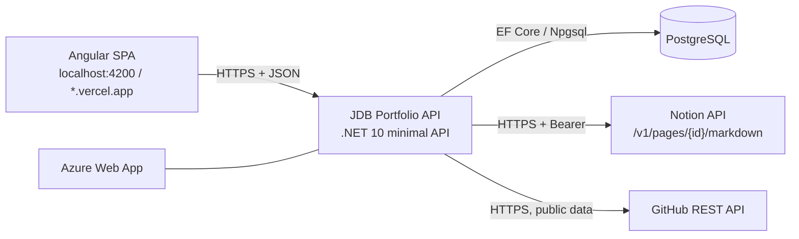
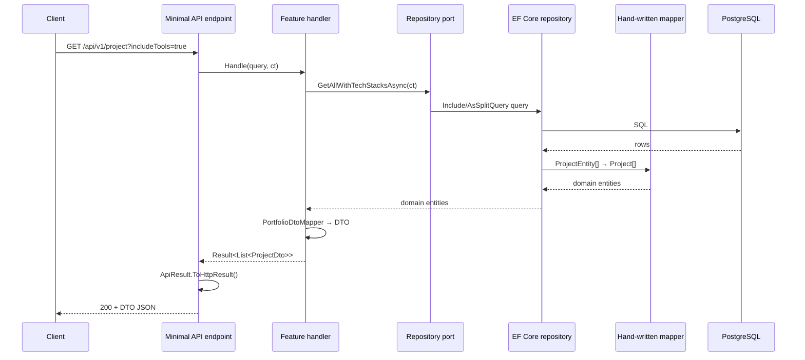

# Architecture

Descriptive: how the system is built **today**, and what it is meant to become.
Normative rules live in [`../.opencode/rules/architecture.md`](../.opencode/rules/architecture.md).

## 1. System context



Single bounded context: **Portfolio**. Read-only. No message broker, no cache, no
background jobs, no identity provider.

## 2. Projects and layout

Phase 2 collapsed the five layered Portfolio projects into one Web SDK project.
Phase 3 is in progress: `src/JGBackend` now composes Portfolio features and owns
the single appsettings/User Secrets store and EF startup project. Portfolio keeps
its own host until the final merge step.

```
src/
├── JGBackend/               host: Program.cs, middleware, configuration
├── Core/                    shared auth, rate limiting, forwarded headers
└── Portfolio/               one project; still its own host in phase 2
    ├── Program.cs           composition root and middleware pipeline
    ├── ConfigurationSettings.cs  host-only Swagger, JWT, CORS, exception handling
    ├── Portfolio.csproj
    ├── Features/
    │   ├── DependencyInjection.cs  AddPortfolioFeatures / MapPortfolioFeatures
    │   ├── Experience/         endpoint, handler, repository, DTO
    │   ├── Project/
    │   ├── Skill/
    │   ├── Recommendation/
    │   ├── Overview/
    │   ├── Notion/
    │   └── Github/
    └── Shared/
        ├── Common/           Result<T>, typed errors, value objects
        ├── Endpoints/        the single Result → IResult mapper
        ├── ErrorHandling/    GlobalExceptionHandler
        └── Persistence/      EF context, entities, mappers, repositories, migrations
```

Feature code lives under `Features/<Slice>/`; only genuinely shared code lives
under `Shared/`. Existing namespaces still follow the old layered names where
types are shared (`Portfolio.Application.*`, `Portfolio.Domain.*`,
`Portfolio.Persistence.*`). They are preserved to keep the diff and published
contracts stable; do not rename them as part of a file move.

Tests mirror the source: `tests/Portfolio/Features/<Slice>/` for slice tests,
`tests/Portfolio/Shared/{Common,Persistence,Testing}/` for shared support, and
`tests/Portfolio/Portfolio.Api.Tests/` for host-level contracts. There are still
four Portfolio test projects; all reference `src/Portfolio/Portfolio.csproj`.

## 3. Dependency rules

Within the single Portfolio project:

- A feature may depend on `Shared/Common` and `Shared/Persistence`.
- A feature must not depend on another feature's internals; cross-slice reads go
  through a repository port or a DTO in the owning slice.
- `Shared/Persistence` must not depend on a feature or on HTTP types.
- `Shared/Common` must not depend on EF Core, ASP.NET, or vendor clients.
- Only `Program.cs` and `Features/DependencyInjection.cs` compose object graphs.

Domain-oriented types stay free of EF, ASP.NET, HTTP, JSON, and vendor types even
though they no longer live in a separate assembly.

## 4. Request flow

### Portfolio reads



Two things to notice:

1. **Domain types stop at the handler boundary.** The handler maps domain → DTO
   by hand (`PortfolioDtoMapper`, ADR-0004); the endpoint signature and the
   response contain DTOs only.
2. `Result<T>` carries a typed `Error`. `Shared/Endpoints/ApiResult.cs` is the
   only place that maps the error kind to a status code (`503` for this API's
   database, `502` for Notion or GitHub, `500` for a bug). `GlobalExceptionHandler`
   covers exceptions that escape a handler.

### Notion and GitHub

Notion and GitHub slices call their clients from a handler, parse or project the
vendor response, and return the same DTO + `Result<T>` shape. Their read endpoints
are anonymous by design.

### Write (not built)

There is no write path. `IRepository<T>` exposes only reads. Revisit a unit-of-work
abstraction only when writes are introduced; `Project` is the aggregate root
(ADR-0003).

## 5. Composition root

`Program.cs` is the only place the graph is assembled:

```
builder.Services
  .AddPresentation(configuration, environment)  → Swagger, JWT, CORS, ProblemDetails
  .AddPortfolioFeatures(configuration)           → DbContext, repositories, handlers,
                                                   Notion, GitHub
  .AddEndpointsApiExplorer()                     → let Swagger see the minimal-API endpoints

app
  .UseExceptionHandler()     → ProblemDetails for anything that escapes
  .UseCors("AllowSPA")
  .UseHttpsRedirection()
  .UseAuthentication()
  .UseAuthorization()
  app.MapGroup("/api/v1") → .MapAuthEndpoints() / .MapPortfolioFeatures()
```

`JGBackend` now assembles this feature graph with `AddPortfolioFeatures()` and
maps the portfolio routes under its own `/api/v1` group. Its appsettings and
User Secrets are the canonical source for the DB, GitHub, Notion, CORS, and
Swagger settings; EF commands use it as `--startup-project`.

Current behavior of the temporary Portfolio host:

- `Database.Migrate()` runs at startup inside a scope when
  `Database:AutoMigrate` is enabled (default `true`).
- Swagger is Development-only, or on when `Swagger:Enabled` is true.
- There are no controllers and no `AddControllers()` / `MapControllers()` calls.

## 6. Cross-cutting concerns

| Concern | Today | Gap |
|---|---|---|
| Error handling | typed `Result<T>` → one `ApiResult` mapper → `503`/`502`/`500`; `GlobalExceptionHandler` for escapes | — |
| Logging | `ILogger` in handlers and repositories; warning for a dependency failure, error for a bug | no structured sink or correlation id beyond `traceId` |
| Validation | explicit `AuthDto` guard in `AuthEndpoints` → `400 + validation_failed` | no other endpoint takes input |
| Cancellation | `CancellationToken` from endpoint → handler → repository → `ToListAsync(ct)` / `GetAsync(ct)` | — |
| Mapping | hand-written mappers for entity ↔ domain; `PortfolioDtoMapper` for domain → DTO (ADR-0004) | reverse mappings are unused until a write path exists |
| Auth | JWT **service token** (`sub=portfolio-api`) owned by `Core` and mapped by `JGBackend`; only `/auth/me` requires it; portfolio, Notion, and GitHub reads are anonymous on purpose | unified JWT lifetime is still a phase-3 step |
| Observability | none | no health check, no metrics, no tracing |
| Resilience | Notion client: 15s timeout, one retry on 429/5xx | no circuit breaker; passthrough rate limits are phase 3 |

## 7. Deployment topology

- **CI:** GitHub Actions on every push and pull request — restore, build
  Release, `dotnet test`. Two path-filtered deploy workflows ship the apps.
- **Hosts:** Azure Web Apps (`jdbweb` for the host, `jdb-portfolio-api` for
  Portfolio) until the single-host merge; single instance each.
- **Database:** PostgreSQL, connection via `ConnectionStrings__JDBConnection`.
- **Docker:** multi-stage images; `docker/compose.portfolio.yaml` runs the API
  only and expects an external PostgreSQL supplied through `.env`.

## 8. Where this is going

Phase 2 is complete: Portfolio is one project organised by vertical slice,
AutoMapper is gone, and feature DI/route mapping is centralized in
`Features/DependencyInjection.cs`. Wire contracts, tags, operation names, and
status codes are unchanged.

Phase 3 has composed `src/Portfolio` into `src/JGBackend`, consolidated
configuration into the host, and replaced Portfolio's duplicate auth with
`Core`. Remaining: unify JWT lifetime on `Jwt:ExpirationInMinutes`, add
passthrough rate limits, and retire the second host/deployable.
Current design details are in this document and [`domain-model.md`](domain-model.md);
schema details are in [`database.md`](database.md), and published contracts are
in [`api-reference.md`](api-reference.md). Open decisions are tracked as ADRs in
[`adr/`](adr/).
