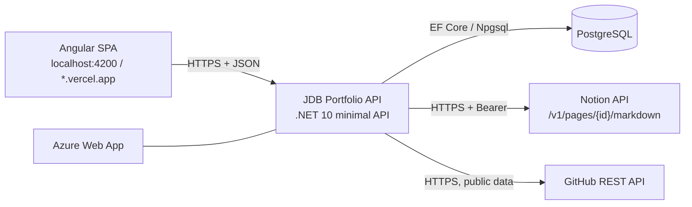
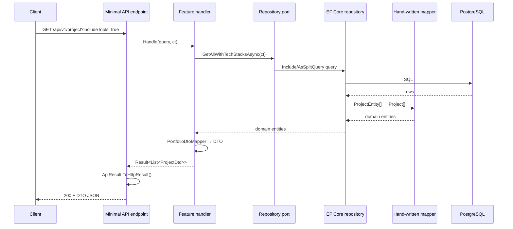

# Architecture

Descriptive: how the system is built **today**, and what it is meant to become.
Normative rules live in [`../.opencode/rules/architecture.md`](../.opencode/rules/architecture.md).

## 1. System context



Single bounded context: **Portfolio**. Read-only. No message broker, no cache, no
background jobs, no identity provider.

## 2. Projects and layout

Phase 2 collapsed the five layered Portfolio projects into one project.
Phase 3 made `src/JGBackend` the sole host: it composes both modules and owns the
appsettings/User Secrets store, the middleware pipeline, and the EF startup
project. `src/Portfolio` is now a class library.

```
src/
├── JGBackend/               host: Program.cs, middleware, configuration
├── Core/                    shared auth, health, rate limiting, forwarded headers
└── Portfolio/               class library: vertical slices
    ├── Portfolio.csproj
    ├── Features/
    │   ├── DependencyInjection.cs  AddPortfolioFeatures / MapPortfolioFeatures
    │   ├── Experience/         endpoint, handler, repository, DTO
    │   ├── Project/
    │   ├── Skill/
    │   ├── Recommendation/
    │   ├── Overview/
    │   ├── Notion/
    │   └── Github/
    └── Shared/
        ├── Common/           Result<T>, typed errors, value objects
        ├── Endpoints/        the single Result → IResult mapper
        └── Persistence/      EF context, entities, mappers, repositories, migrations
```

Feature code lives under `Features/<Slice>/`; only genuinely shared code lives
under `Shared/`. Existing namespaces still follow the old layered names where
types are shared (`Portfolio.Application.*`, `Portfolio.Domain.*`,
`Portfolio.Persistence.*`). They are preserved to keep the diff and published
contracts stable; do not rename them as part of a file move.

Tests mirror the source: `tests/Portfolio/Features/<Slice>/` for slice tests,
`tests/Portfolio/Shared/{Common,Persistence,Testing}/` for shared support, and
`tests/Portfolio/Portfolio.Api.Tests/` for host-level contracts. There are still
four Portfolio test projects; all reference `src/Portfolio/Portfolio.csproj`.

## 3. Dependency rules

Within the single Portfolio project:

- A feature may depend on `Shared/Common` and `Shared/Persistence`.
- A feature must not depend on another feature's internals; cross-slice reads go
  through a repository port or a DTO in the owning slice.
- `Shared/Persistence` must not depend on a feature or on HTTP types.
- `Shared/Common` must not depend on EF Core, ASP.NET, or vendor clients.
- Only `Program.cs` and `Features/DependencyInjection.cs` compose object graphs.

Domain-oriented types stay free of EF, ASP.NET, HTTP, JSON, and vendor types even
though they no longer live in a separate assembly.

## 4. Request flow

### Portfolio reads



Two things to notice:

1. **Domain types stop at the handler boundary.** The handler maps domain → DTO
   by hand (`PortfolioDtoMapper`, ADR-0004); the endpoint signature and the
   response contain DTOs only.
2. `Result<T>` carries a typed `Error`. `Shared/Endpoints/ApiResult.cs` is the
   only place that maps the error kind to a status code (`503` for this API's
   database, `502` for Notion or GitHub, `500` for a bug). `GlobalExceptionHandler`
   covers exceptions that escape a handler.

### Notion and GitHub

Notion and GitHub slices call their clients from a handler, parse or project the
vendor response, and return the same DTO + `Result<T>` shape. Their read endpoints
are anonymous by design.

### Admin writes

Started with the `recommendation` slice and rolled out slice by slice. The flow is
the read flow in reverse:

```
Client → Admin endpoint → Create/Update/Delete handler → IRecommendationRepository
       → PortfolioWriteContext → RecommendationEntity → SaveChangesAsync(ct)
       → domain → RecommendationDto → Result<T> → ApiResult
```

`EfRecommendationRepository` is the single port for the aggregate. Its inherited
`GetAllAsync`, `GetByIdAsync` (including the anonymous detail GET and the
pre-write lookup) use `PortfolioContext` (read-only credential); `AddAsync`,
`UpdateAsync` and `DeleteAsync` use `PortfolioWriteContext` (DML credential).
That keeps every public read off the writer connection without splitting one
aggregate into two repository abstractions.

A write command calls `SaveChangesAsync` once, so it saves one aggregate per
transaction (ADR-0003). There is still no `IUnitOfWork`. `postedAt` is set from an
injected `TimeProvider`, never from request JSON; update goes through
`Recommendation.ChangeDetails(...)`, so the domain invariant runs on edits as well
as construction. No audit table is written (ADR-0007).

The `skill` slice follows the same pattern with two ports: `ISkillRepository`
for the stack aggregate and `ITechStackCategoryRepository` for the shared
category reference data. A stack write resolves the category by name through the
read credential, then writes the stack with the category id through the writer.
`TechStack.UpdateDetails` and `TechStackCategory.Rename` keep the invariants on
edits. Deletes guard the join-table foreign keys with `409 + conflict`, and the
anonymous detail GETs make the `201` `Location` followable without a token.

## 5. Composition root

`src/JGBackend/Program.cs` is the only place the graph is assembled:

```
builder.Services
  .AddSwaggerConfig() / .AddCorsOrigins() / .AddInfrastructure() / .AddFeatures()
  .AddPortfolioFeatures(configuration)   → read + write DbContexts, repositories,
                                           handlers, Notion, GitHub
  .AddAuthentication() / .AddRateLimitingConfig() / .AddForwardedHeadersConfig()

app
  .UseForwardedHeaders() / .UseExceptionHandler() / .UseCors("AllowSPA")
  .UseHttpsRedirection() / .UseRateLimiter() / .UseAuthentication() / .UseAuthorization()
  .MapHealthChecks("/healthz") / .MapFeatures()
  .MapGroup("/api/v1") → .MapPortfolioFeatures(notionPolicy, githubPolicy)
```

The host assembles the Portfolio feature graph with `AddPortfolioFeatures()` and
maps its routes under `/api/v1`, passing the passthrough, default and
admin-write rate-limit policy names.
Its appsettings and User Secrets are the canonical source for DB, GitHub, Notion,
CORS, and Swagger settings; EF commands use it as `--startup-project`.

Current behavior of the host:

- `Database.Migrate()` runs at startup inside a scope when
  `Database:AutoMigrate` is enabled (default `true`; disabled in production).
- Swagger is Development-only, or on when `Swagger:Enabled` is true.
- There are no controllers and no `AddControllers()` / `MapControllers()` calls.

## 6. Cross-cutting concerns

| Concern | Today | Gap |
|---|---|---|
| Error handling | typed `Result<T>` → one `ApiResult` mapper → `503`/`502`/`500`; `GlobalExceptionHandler` for escapes | — |
| Logging | `ILogger` in handlers and repositories; warning for a dependency failure, error for a bug | no structured sink or correlation id beyond `traceId` |
| Validation | explicit guards in `AuthEndpoints` and admin write handlers → `400 + validation_failed` | — |
| Cancellation | `CancellationToken` from endpoint → handler → repository → `ToListAsync(ct)` / `SaveChangesAsync(ct)` / `GetAsync(ct)` | — |
| Mapping | hand-written mappers for entity ↔ domain in both directions (the write path uses domain → entity); `PortfolioDtoMapper` for domain → DTO (ADR-0004) | — |
| Auth | JWT **service token** (`sub=portfolio-api`, `role=Admin`) owned by `Core` and mapped by `JGBackend`; lifetime from `Jwt:ExpirationInMinutes`; `Admin` is the fallback policy, so new endpoints fail closed; public reads opt out with `.AllowAnonymous()`; admin writes live under `/api/v1/admin` and opt in explicitly (ADR-0007) | — |
| Observability | `/healthz` liveness and `/api/v1/health` diagnostics (version, environment, uptime) | admin writes are logged, not audited to a table |
| Resilience | Notion client: 15s timeout, one retry on 429/5xx; per-IP fixed-window policies applied as endpoint metadata by the host — 120/min `default`, 5/min login, 30/min per passthrough, 30/min `admin-write`; health probes are exempt | no circuit breaker; limits are per instance |

## 7. Deployment topology

- **CI:** GitHub Actions on every push and pull request — restore, build
  Release, `dotnet test`. One path-filtered deploy workflow ships the app.
- **Host:** one Azure Web App (`jdbweb`) running the composed host.
- **Database:** PostgreSQL. Reads and migrations use `ConnectionStrings__JDBConnection`
  (`PortfolioContext`); admin writes use `ConnectionStrings__JDBConnectionWrite`
  (`PortfolioWriteContext`, DML-only credential). Migrations always use the read
  context and the CI-owned owner connection (ADR-0007).
- **Docker:** one multi-stage image; `docker/compose.yaml` runs the API only and
  expects an external PostgreSQL supplied through `.env`.

## 8. Where this is going

Phase 2 is complete: Portfolio is one project organised by vertical slice,
AutoMapper is gone, and feature DI/route mapping is centralized in
`Features/DependencyInjection.cs`. Wire contracts, tags, operation names, and
status codes are unchanged.

Phase 3 completed the single-host merge: configuration, auth, JWT lifetime and
rate-limit policies live in the host/`Core`, Portfolio is a class library, and
the second Web App, Dockerfile, compose stack, and deploy workflow are retired.
The owner completed the repo rename, federated credential update, GitHub
secrets, and `jdbweb` settings on 2026-11-22; retiring the old Web App remains
open in [`operations.md`](operations.md) §8.
Current design details are in this document and [`domain-model.md`](domain-model.md);
schema details are in [`database.md`](database.md), and published contracts are
in [`api-reference.md`](api-reference.md). Open decisions are tracked as ADRs in
[`adr/`](adr/).
