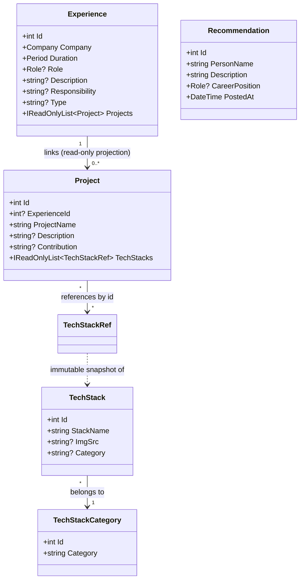

# Domain model

Descriptive: what the model is **today**. The aggregate decision is recorded in
[`adr/0003-aggregate-boundary.md`](adr/0003-aggregate-boundary.md).

## 1. Bounded context

**Portfolio** — everything a visitor needs to read about a person's professional
history: roles held, projects delivered, technologies used, and what other people
said about them.

Out of scope for this context: writing content (no write endpoints), user
accounts, contact form, analytics, CMS.

## 2. Ubiquitous language

| Term | Meaning in this codebase |
|---|---|
| **Experience** | A role held at a company for a period. The closest thing to an aggregate root for employment history. |
| **Project** | Work delivered, optionally attached to an experience. |
| **TechStack** | A tool/technology, shared reference data. |
| **TechStackCategory** | Grouping for tech stacks (e.g. frontend, backend). |
| **Recommendation** | A testimonial: person, position, text, date. |
| **DashboardItem** | A UI widget count (projects/skills/recommendations). Not a domain concept. |
| **Role** | A job title value object (non-empty, ≤ 50 chars). |
| **Company** | An employer name value object (non-empty, ≤ 255 chars). Required on every experience. |
| **Period** | A time range with an optional end. |

## 3. Aggregate map (current)



**The boundary is settled (ADR-0003, 3.4).** `Project` is the aggregate root and the
only thing that owns the relationship: a project may exist with no experience, and
`Experience.Projects` is a read-only projection of the projects that point at it.
`TechStack` is shared reference data, so a project cites a `TechStackRef` (id + name +
image + category) rather than holding the entity — one project cannot mutate a stack
every other project cites. Admin writes are added slice by slice under ADR-0007;
`Project` remains the only write entry point for projects.

## 4. Entities

| Entity | Identity | Constructor | Mutability | Invariants enforced |
|---|---|---|---|---|
| `Experience` | `int Id` (DB identity) | `(id, company, period, role)` | `Id` get-only; `Company`/`Duration`/`Role`/`Description`/`Responsibility`/`Type` private set through `UpdateDetails`; `Projects` `IReadOnlyList` + `ReplaceProjects` | `Company` is **required** (3.1a, also enforced on edit by admin CRUD); `Role` is **optional** — `null` means the role is deliberately undeclared (a blank edit input clears it); `Role`/`Company`/`Period` rules via VOs on create and edit |
| `Project` | `int Id` (get-only) | `(id, projectName)` or `(id, experienceId, projectName, description, contribution, techStacks)` | id get-only; name/description/contribution private set through `UpdateDetails`; experience link and refs private through `AttachToExperience`/`ReplaceTechStacks` | **name non-blank** (3.3, also enforced on edit by admin CRUD); holds `IReadOnlyList<TechStackRef>`, never `TechStack` entities (3.4). `Period` was removed on 2026-10-22: it had no column and no mapping, so it was always `null` |
| `TechStack` | `int Id` (get-only) | `(id, stackName, imgSrc, category)` | name/img private via `UpdateDetails`; category private via `SetCategory` | **name non-blank**; **category non-blank when present**, `null` allowed (3.3) |
| `TechStackCategory` | `int Id` (get-only) | `(id, category)` | name private via `Rename` | **name non-blank** (3.3) |
| `Recommendation` | `int Id` (get-only) | `(id, personName, description, careerPosition, postedAt)` | `Id`/`PostedAt` get-only; name/description/career position private via `ChangeDetails` | `PersonName` and `Description` **non-blank** (3.3, closes KI-041; also enforced on edit by admin CRUD); `CareerPosition` is **optional** — `null` means it is deliberately not shown |

Behaviour that exists:

- `Experience.ChangeRole(Role?)` — sets or clears the role; `null` means "not declared".
- `Experience.UpdateDetails(company, startedAt, finishedAt, role, description, responsibility, type)` — the admin edit path. It builds every value object before assigning anything, so a rejected company, period or role leaves the aggregate unchanged; the `Projects` projection is never touched.
- `Experience.UpdateDescription` / `UpdateResponsibility` / `UpdateType` — the last two were added by 3.3; before, the entity could not express its own fields and AutoMapper wrote them by reflection.
- `Experience.ReplaceProjects(IEnumerable<Project>?)` — copies the argument; `null` means none.
- `Project.AttachToExperience`, `UpdateDescription`, `UpdateContribution`, `ReplaceTechStacks`.
- `Project.UpdateDetails(string, string?, string?)` — the admin edit path; it never touches the experience link or the stack refs.
- `Project.ReplaceTechStacks(IEnumerable<TechStackRef>?)` — the admin join path. The refs must already be resolved from shared stack rows, so only their ids reach `project_tech_stack`.
- `Recommendation.ChangeDetails(string, string, Role?)` — the admin edit path; it preserves `PostedAt`.
- `TechStack.SetCategory(string?)` — rejects blank, allows `null`; `TechStack.UpdateDetails(name, imgSrc)` — rejects a blank name.
- `TechStackCategory.Rename(string)` — rejects a blank name.
- Nothing else. `Id` and `PostedAt` are fixed; every editable field moves only through the methods above.

## 5. Value objects

| VO | Type | Validation | Equality | Notes |
|---|---|---|---|---|
| `Role` | `sealed record` | non-empty, ≤ 50 | **value** | "not disclosed" is `Role? == null`, never `""` |
| `Company` | `sealed record` | non-empty, ≤ 255 | **value** | never absent: "not disclosed" is not a thing for an employer, so there is no `Company?`. The empty-string concept is gone |
| `Period` | `sealed record` | no `default` dates; `FinishedAt >= StartedAt`; `StartedAt` not in the future | **value** | `FinishedAt == null` means *ongoing* — see `IsOngoing` |
| `TechStackRef` | `sealed record` | non-blank name; non-blank category when present | **value** | A project's citation of a shared stack (3.4): identified by `Id`, immutable, so mutating one project's stack cannot reach another project |

Since 3.1 these hold:

```csharp
new Role("Developer") == new Role("Developer")        // true
new Company("Acme")    == new Company("Acme")         // true
new Period(start)      == new Period(start)           // true
```

and the three can be dictionary keys. Records generate `Equals`/`GetHashCode`/`==`
over every instance field, and each property is `get`-only, so the invariants hold:
a `with` expression cannot change a value and skip validation.

`Period.IsOngoing` names a fact that used to be folklore: it is true only when there
is a start date and no end date. `StartedAt == null && FinishedAt == null` is
"unknown", not "ongoing" — the two are different, and the mapper treats them
differently.

**One consequence to know about.** `Period` refuses a start date in the future
(compared by date, so time of day never decides). The mapping constructs a `Period`
for every row, so a future-dated row in the database throws while reading and returns
`500` for the whole collection rather than rendering a nonsense duration. That is
deliberate — a typo such as `2062` should be loud. Admin input is checked by
`ExperienceRequestValidator` before the value object is built, so a bad write gets
`400` instead.

## 6. Enforced invariants

| Invariant | Enforcement |
|---|---|---|
| `Project.ProjectName` is non-blank | `Project` constructor and `Project.UpdateDetails` |
| A project is linked to at most one experience | `Project.AttachToExperience`, used by `POST /api/v1/admin/experience/{experienceId}/project`; the link is optional |
| `TechStack.StackName` and `TechStackCategory.Category` are non-blank | Entity constructors, `TechStack.UpdateDetails` and `TechStackCategory.Rename` |
| `TechStack.Category` is non-blank when present | `TechStack.SetCategory`; `null` is allowed |
| `Recommendation.PersonName` and `Description` are non-blank | `Recommendation` constructor and `Recommendation.ChangeDetails` |
| `Period.FinishedAt` is not before `StartedAt` | `Period` constructor, used by `Experience.UpdateDetails` |
| `Role` is non-empty and at most 50 characters | `Role` constructor, used by `Experience.UpdateDetails` |
| `Company` is non-empty and at most 255 characters | `Company` constructor, used by `Experience.UpdateDetails`; the database also has `NOT NULL` and a non-blank `CHECK` |
| A role cannot start in the future | `Period` constructor, used by `Experience.UpdateDetails` |
| Persistence audit fields are absent from domain entities | Domain model shape |

## 7. Types in their owning layer

| Type | Where it is | Should be | Status |
|---|---|---|---|
| `DashboardItem` | `Features/Overview` (`OverviewItemDto`) | — | A read model with no domain invariant |
| `NotionPage` | `Features/Notion` (vendor); `PageContent` (handler-facing) | — | The handler reads `PageContent` through `IPageContentReader` |
| `INotionService` | `Features/Notion/IPageContentReader` | — | `NotionPageContentReader` bridges the port to the Notion client |
| `ExperienceId` | deleted | — | Unused identifier type removed |
| `IService<T>` / `IMapper<,,>` | deleted | — | Unused abstractions removed |

Everything in this table is now resolved. The Notion pair still needs a bridge:
the handler-facing `PageContent` stays out of the vendor payload, and
`NotionPageContentReader` translates between them inside the Notion slice
(ADR-0005). The layered names in the table are historical; phase 2 moved the code
into `Features/Notion` without changing published contracts.

## 8. Domain events

None. There is no write path, so there is nothing to publish. When writes are
introduced, events should be raised by the aggregate and dispatched after
`SaveChanges`, not from the service.

## 9. Rules for changing the model

1. A new invariant gets a test **first** (see `rules/testing.md`).
2. Never add a public setter to fix a mapping problem — fix the mapping.
3. A value object that wraps a scalar gets a `record` and a validating
   constructor.
4. If a type has no behaviour and no invariant, ask whether it belongs in Domain
   at all.
5. Any change to the aggregate boundary needs an ADR.
